# Exception Class Diagram - GameZone Unicesar

Updated class diagram for Requirement 6 (validations and exceptions). It shows:

1. The new hierarchy of custom exceptions (`com.gamezone.exceptions`), with
   `GameZoneException` as the root and its four specialized subclasses.
2. The new validators (`com.gamezone.validation`), one per functional module, with their
   main methods.
3. How the existing services invoke the validators and throw the custom exceptions, and how
   the repositories turn `IOException` into `PersistenceException`.
4. The relationship between `ConsoleMenu` and the exception hierarchy when it handles each
   type of error with a different message.

Dependency rules:

- `ui → service → persistence → model`, as in the Workshop.
- The `exceptions` layer is transversal: any layer can throw or catch its classes.
- The `validation` layer sits logically between `service` and `model`: services call the
  validators, and the validators use only model classes and exceptions. Validators never call
  services or repositories and contain no file access logic.

```mermaid
classDiagram
    direction TB

    namespace exceptions {
        class GameZoneException {
            <<abstract>>
            -errorCode: String
            +GameZoneException(message: String)
            +GameZoneException(message: String, errorCode: String)
            +getErrorCode() String
        }
        class ResourceNotFoundException {
            +ResourceNotFoundException(resourceType: String, id: String)
        }
        class BusinessRuleException {
            +BusinessRuleException(message: String)
        }
        class InvalidDataException {
            +InvalidDataException(fieldName: String, description: String)
        }
        class PersistenceException {
            +PersistenceException(message: String, cause: Throwable)
        }
    }

    namespace validation {
        class ProductValidator {
            -ProductValidator()
            +validateProductData(id: String, title: String, price: double, stock: int)$ void
            +validateStockAvailability(product: Product, requestedQuantity: int)$ void
            +validateProductExists(product: Product, productId: String)$ void
        }
        class PersonValidator {
            -PersonValidator()
            +validatePersonData(id: String, name: String, email: String, phone: String)$ void
            +validatePersonExists(person: Person, personId: String)$ void
            +validateUniquePerson(existing: List~Person~, newId: String)$ void
        }
        class SaleValidator {
            -SaleValidator()
            +validateSaleData(client: Client, seller: Seller, products: List~Product~)$ void
            +validateSaleExists(sale: Sale, saleId: String)$ void
        }
    }

    namespace service {
        class ProductService {
            -repository: ProductRepository
            -products: List~Product~
            +registerVideoGame(videoGame: VideoGame) void
            +registerConsole(console: Console) void
            +findById(id: String) Product
            +decreaseStock(productId: String, amount: int) void
            +restoreStock(productId: String, amount: int) void
        }
        class PersonService {
            -repository: PersonRepository
            -clients: List~Client~
            -vendors: List~Seller~
            +registerClient(client: Client) void
            +findClientById(id: String) Client
            +findSellerById(id: String) Seller
        }
        class SaleService {
            -sales: List~Sale~
            -salePersistence: SalePersistence
            -productService: ProductService
            -personService: PersonService
            +registerSale(clientId: String, sellerId: String, productIds: List~String~, productIdsWithExtendedWarranty: List~String~) Sale
            +findById(saleId: String) Sale
        }
    }

    namespace persistence {
        class ProductRepository {
            -filePath: String
            +save(products: List~Product~) void
            +load() List~Product~
        }
        class PersonRepository {
            +saveClients(clients: List~Client~) void
            +loadClients() List~Client~
            +loadVendors() List~Seller~
        }
        class SalePersistence {
            -filePath: String
            +saveAll(sales: List~Sale~) void
            +loadAll(productService: ProductService, personService: PersonService) List~Sale~
        }
    }

    namespace ui {
        class ConsoleMenu {
            -productService: ProductService
            -personService: PersonService
            -saleService: SaleService
            +start() void
        }
    }

    namespace model {
        class Product {
            <<abstract>>
            +getDescription()* String
        }
        class Person {
            <<abstract>>
            +getDescription()* String
        }
        class Client
        class Seller
        class Sale
    }

    class RuntimeException {
        <<Java>>
    }
    class IOException {
        <<Java>>
    }

    %% 1. Exception hierarchy
    RuntimeException <|-- GameZoneException
    GameZoneException <|-- ResourceNotFoundException
    GameZoneException <|-- BusinessRuleException
    GameZoneException <|-- InvalidDataException
    GameZoneException <|-- PersistenceException
    PersistenceException o-- "1" IOException : cause

    %% 2. Validators check model objects and throw the custom exceptions
    ProductValidator ..> Product : checks
    PersonValidator ..> Person : checks
    SaleValidator ..> Client : checks
    SaleValidator ..> Seller : checks
    SaleValidator ..> Sale : checks
    ProductValidator ..> InvalidDataException : throws
    ProductValidator ..> BusinessRuleException : throws
    ProductValidator ..> ResourceNotFoundException : throws
    PersonValidator ..> InvalidDataException : throws
    PersonValidator ..> BusinessRuleException : throws
    PersonValidator ..> ResourceNotFoundException : throws
    SaleValidator ..> InvalidDataException : throws
    SaleValidator ..> BusinessRuleException : throws
    SaleValidator ..> ResourceNotFoundException : throws

    %% 3. Services invoke the validators before running the business operation
    ProductService ..> ProductValidator : invokes
    PersonService ..> PersonValidator : invokes
    SaleService ..> SaleValidator : invokes
    SaleService ..> ProductValidator : invokes stock and existence checks
    SaleService ..> ResourceNotFoundException : throws item not found

    %% 3. Services use their repositories
    ProductService --> "1" ProductRepository
    PersonService --> "1" PersonRepository
    SaleService --> "1" SalePersistence
    SaleService --> "1" ProductService
    SaleService --> "1" PersonService

    %% 3. Repositories catch IOException and rethrow PersistenceException
    ProductRepository ..> IOException : catches
    PersonRepository ..> IOException : catches
    SalePersistence ..> IOException : catches
    ProductRepository ..> PersistenceException : throws
    PersonRepository ..> PersistenceException : throws
    SalePersistence ..> PersistenceException : throws

    %% 4. ConsoleMenu uses the services and catches each exception type
    ConsoleMenu --> "1" ProductService
    ConsoleMenu --> "1" PersonService
    ConsoleMenu --> "1" SaleService
    ConsoleMenu ..> ResourceNotFoundException : catches
    ConsoleMenu ..> BusinessRuleException : catches
    ConsoleMenu ..> InvalidDataException : catches
    ConsoleMenu ..> PersistenceException : catches

    %% Model inheritance (unchanged)
    Person <|-- Client
    Person <|-- Seller
```

## Validation rules and exceptions thrown

| Validator method | Rule checked | Exception |
|---|---|---|
| `ProductValidator.validateProductData` | Id and title not null or empty; price greater than zero; stock not negative | `InvalidDataException` |
| `ProductValidator.validateStockAvailability` | Stock of the product is enough for the requested quantity | `BusinessRuleException` |
| `ProductValidator.validateProductExists` | Product is not null | `ResourceNotFoundException` |
| `PersonValidator.validatePersonData` | Required fields not empty; email contains `@` and `.` | `InvalidDataException` |
| `PersonValidator.validatePersonExists` | Person is not null | `ResourceNotFoundException` |
| `PersonValidator.validateUniquePerson` | No other person has the same id | `BusinessRuleException` |
| `SaleValidator.validateSaleData` | Client and seller not null; product list not empty | `InvalidDataException` / `BusinessRuleException` |
| `SaleValidator.validateSaleExists` | Sale is not null | `ResourceNotFoundException` |

## Messages shown by ConsoleMenu

| Exception caught | Message shown to the user |
|---|---|
| `ResourceNotFoundException` | "No se encontró el recurso solicitado: <detalle>" |
| `BusinessRuleException` | "No se puede completar la operación: <detalle>" |
| `InvalidDataException` | "Los datos ingresados no son válidos: <detalle>" |
| `PersistenceException` | "Ocurrió un problema al acceder a los datos del sistema. Contacte al administrador." |

## Notes about names

- The statement calls the sales repository `SaleRepository`; in this project the class is
  `SalePersistence` (name kept since the Workshop). It plays the role of `SaleRepository`.
- The statement uses `Customer` in `SaleValidator.validateSaleData`; in this project the
  class is `Client`.
- In the code, `validateUniquePerson` receives `List<? extends Person>` so it accepts a
  `List<Client>`; Mermaid cannot draw the wildcard, so the diagram shows `List<Person>`.
- The validators have a private constructor because they only contain static methods and
  must not be instantiated.
