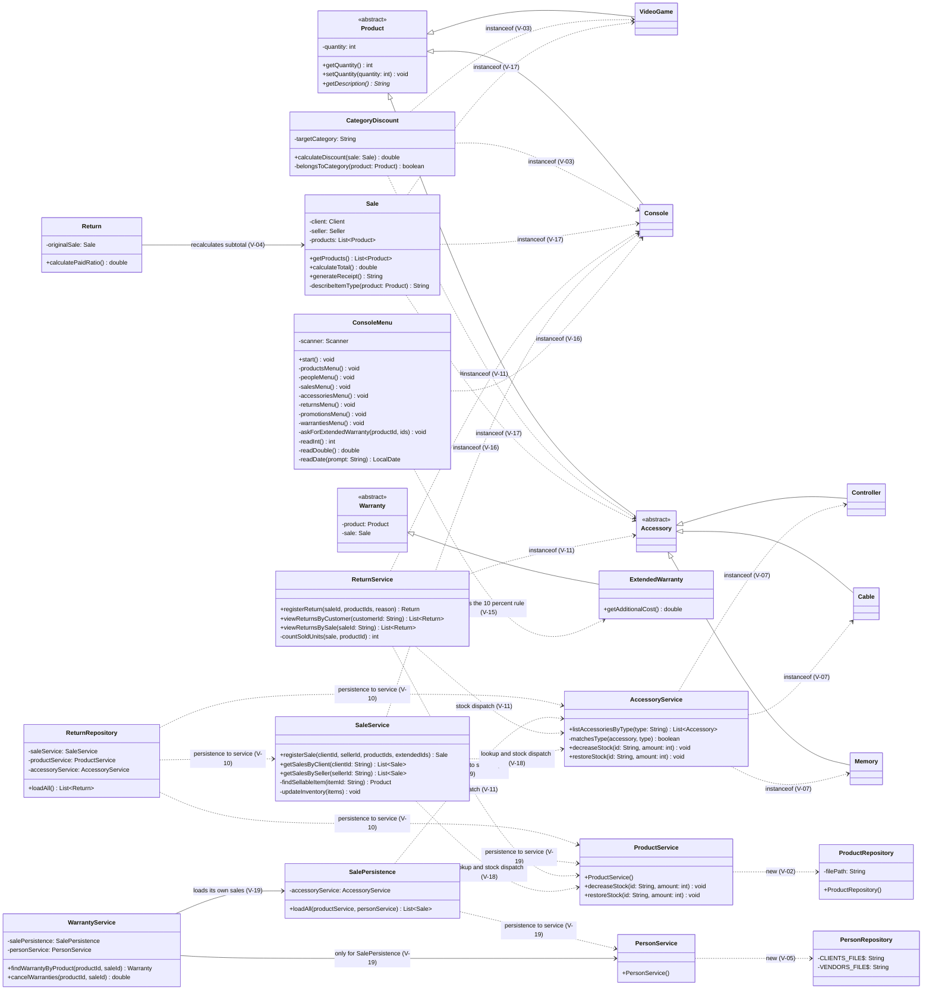

# GRASP Class Diagram — Requerimiento 7

Class diagrams of the parts of the system affected by the GRASP corrections. Only the classes, attributes, methods and relations that take part in a violation of `docs/grasp-audit/consolidated-audit.md` are drawn; the rest of the system is unchanged and is described in the diagrams of the previous requirements.

## Before the correction

State of `develop` at the audited commit `4027852`. The notes name the violations.

Violations that are not visible as a relation:

| ID | Where |
|---|---|
| V-01, V-06, V-14 | `ProductService.decreaseStock`, `AccessoryService.decreaseStock`/`restoreStock` and `ProductService.restoreStock` compute the stock with `getQuantity`/`setQuantity` |
| V-08 | `ReturnService.viewReturnsByCustomer`/`viewReturnsBySale` navigate `Return → Sale → Client` |
| V-09 | `ReturnService.registerReturn` and `countSoldUnits` search the products of the sale |
| V-12 | `WarrantyService` navigates `Warranty → Product` and `Warranty → Sale` |
| V-13 | `SaleService.getSalesByClient`/`getSalesBySeller` and `ConsoleMenu.showWarrantiesOfSale` navigate `Sale` and `Warranty` |
| V-20 | `ConsoleMenu` holds the seven submenus and the input readers (1026 lines) |