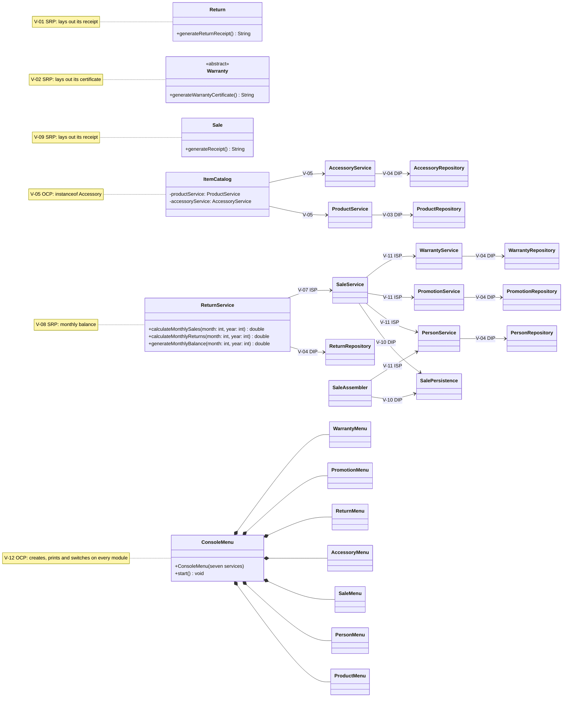
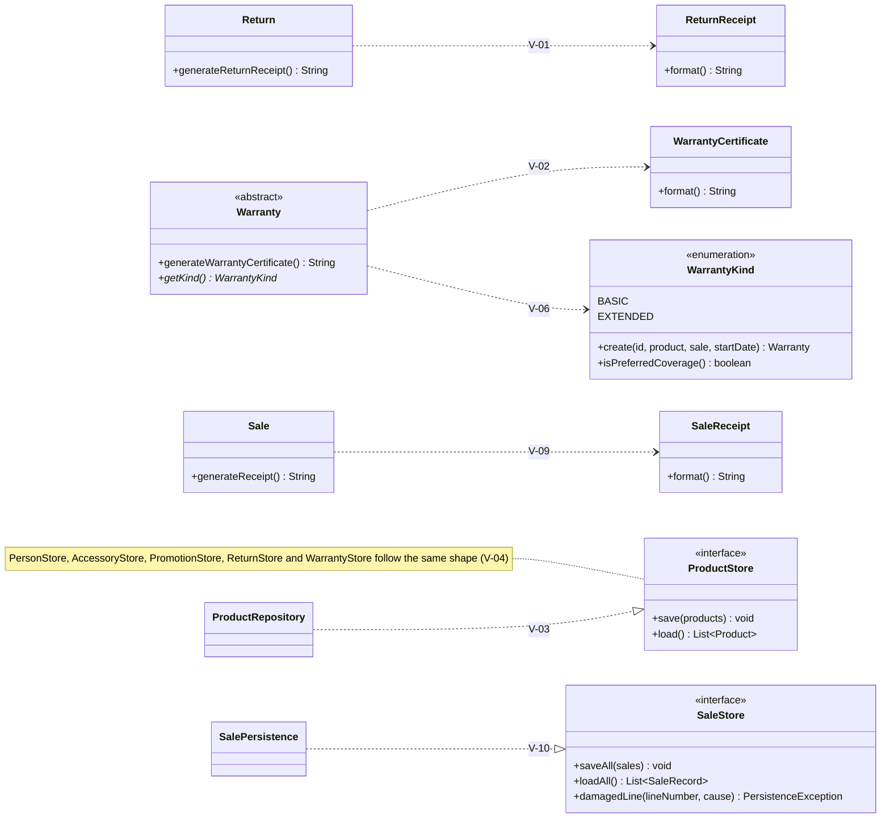
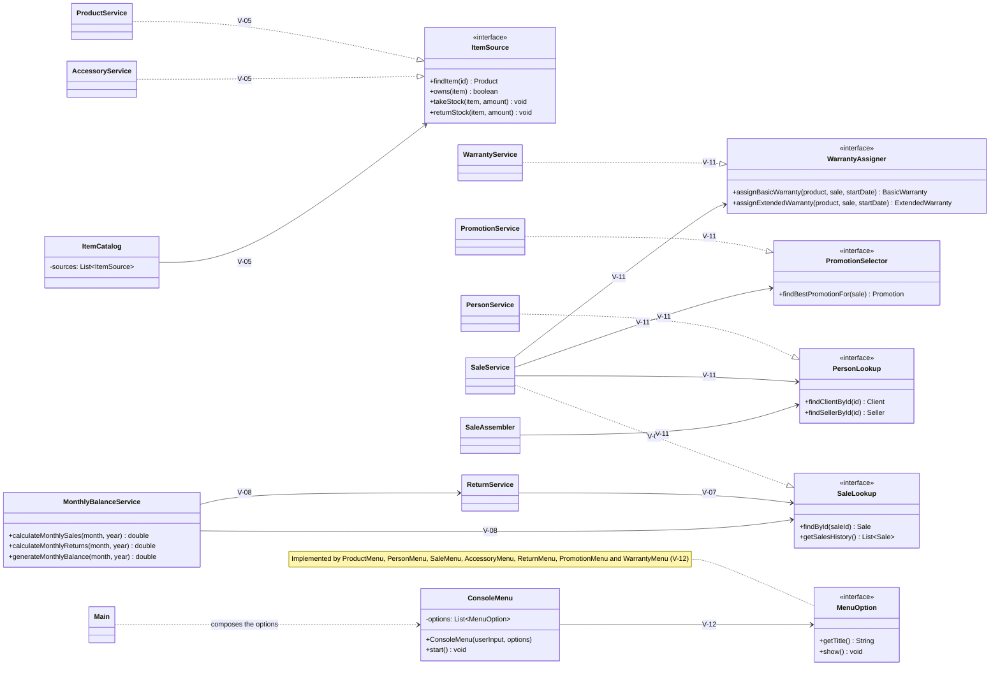

# SOLID Class Diagram — Requerimiento 8

Class diagrams of the parts of the system affected by the SOLID corrections. Only the classes, methods and dependencies that take part in a violation of `docs/solid-audit/consolidated-audit.md` are drawn; the rest of the system is described in the diagrams of the previous requirements and in `docs/grasp-class-diagram.md`.

## Before the correction

State of `develop` at the audited commit. The notes name the violations.

Violations that are not visible as a relation:

| ID | Where |
|---|---|
| V-06 | `WarrantyRepository` writes and reads the kind with tags and `instanceof ExtendedWarranty`; `WarrantyService` chooses and cancels by concrete class |
| V-12 | `ConsoleMenu.start()` prints the seven options one by one and dispatches them with a `switch` |

## After the correction

State of `develop` after the Pull Requests of Phase 2. New interfaces: `ProductStore`, `PersonStore`, `AccessoryStore`, `PromotionStore`, `ReturnStore`, `WarrantyStore`, `SaleStore`, `ItemSource`, `SaleLookup`, `PersonLookup`, `PromotionSelector`, `WarrantyAssigner`, `MenuOption`; new classes: `ReturnReceipt`, `WarrantyCertificate`, `SaleReceipt`, `MonthlyBalanceService`; new enum: `WarrantyKind`. The repositories implement their store with the same names (`ProductRepository` implements `ProductStore`, and so on).

### Model and persistence

### Services and user interface

